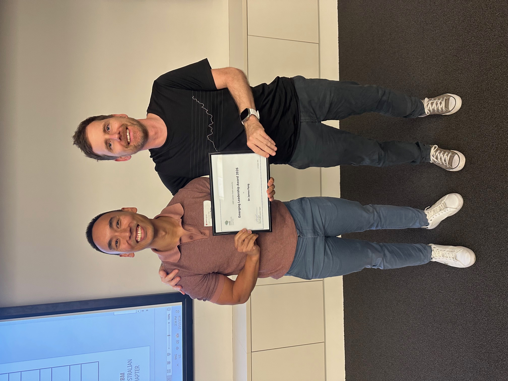
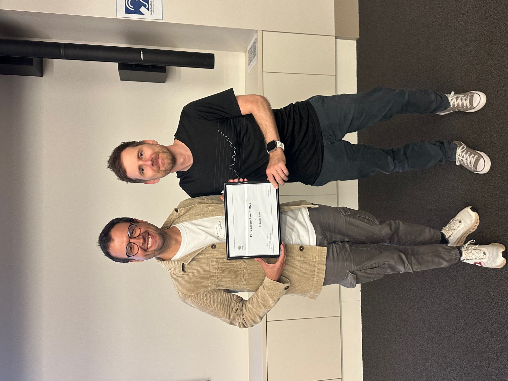

<h2 class="text-primary">
    <i class="fa-solid fa-award"></i> Awardees: OHBM Australia 2026 🏆
</h2>

This year, we were excited to introduce a set of awards to recognize the outstanding contributions our members are making in the field of Human Brain Mapping. We are proud to announce the recipients of this year’s awards. Congratulations to all!

  
  

 

<h2 class="text-primary">
    <i class="fa-solid fa-star"></i> Early Career Researcher Award:
</h2> 

 

    <a href="https://scholar.google.com/citations?user=arDr8VsAAAAJ&hl=de" target="_blank" rel="noopener noreferrer">
        
        <h3 class="text-primary">
            <i class="fa-solid fa-trophy"></i> Dr. Lukas Roell <i class="fa-solid fa-trophy"></i>
        </h3>
    </a>
    Research Fellow, The University of Melbourne

Dr Lukas Roell's research focuses on identifying and validating neuroimaging-derived markers that track and predict specific symptom trajectories in the psychosis risk state using longitudinal study designs. His long-term aim is to evaluate these markers as symptom-specific targets for novel preventive interventions, such as brain stimulation techniques (e.g., focused ultrasound and transcranial magnetic stimulation), in individuals at risk of developing psychosis.

<h2 class="text-primary">
    <i class="fa-solid fa-star"></i> Emerging Leadership Award:
</h2> 

 

    <a href="https://research.monash.edu/en/persons/james-pang/" target="_blank" rel="noopener noreferrer">
        
        <h3 class="text-primary">
            <i class="fa-solid fa-trophy"></i> Dr. James Pang <i class="fa-solid fa-trophy"></i>
        </h3>
    </a>
    NHMRC Research Fellow, Monash University

Dr James Pang is currently a Senior Research Fellow and NHMRC Emerging Leadership Fellow and leads the Computational and Comparative Brain Dynamics Lab at the Turner Institute for Brain and Mental Health, Monash University. His research program employs a multidisciplinary approach that combines multimodal neuroimaging, biophysical computational modelling, and statistical physics to better understand the mechanisms of brain structure and function in health and disease and across species.
